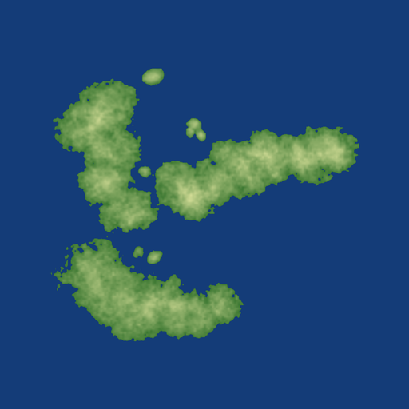
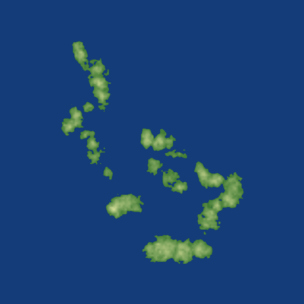

# Boat Crew map tools

A random level generator and map viewer for [Boat Crew](https://store.steampowered.com/app/1633370/). It makes custom levels you can open in the game's level editor: landmasses with bays and peninsulas, archipelagos, or round islands, with a player start, a goal and timed enemy waves already wired up.

<p>
  
  
</p>

> Unofficial fan project, not affiliated with the developer. It contains no game assets.

**[Open the generator and viewer in your browser](https://davidnendza.github.io/boat-crew-map-tools/)**

## Try it in the browser

Use the link above (Chrome or Edge work best). Press **Random map**, tweak the options, then **Download .zip** and unzip it into the game's `GameData/LevelEditor` folder. **Save to folder** writes the files there directly in browsers that allow it (Chrome and Edge; use the zip if yours refuses). No install, and nothing leaves your machine.

To run it offline, clone the repository (or use **Code, Download ZIP**) and open `docs/index.html` from your disk. Opening that file *on GitHub* only shows its source code, which is how GitHub displays any HTML file.

The viewer also opens existing levels (`.BCP` files, or the files from a level folder) and draws the terrain with every node, link and spawner on top, which is handy for checking a level before you load it.

## Put a level in the game

A level is a folder of four files. Put it here, then open the game's level editor and look for it in the list:

```
<Boat Crew install>/Boat Crew_Data/GameData/LevelEditor/<map name>/
    SOURCE_1_Terrain.BCT
    SOURCE_1.BCD
    PreviewData.BCI
    PreviewImage.png
```

It shows up in the **level editor** list, not the user levels list. From there you can edit it or use "save and play". If you re-save in the editor it writes a new `SOURCE_2.BCD`; the highest number is the one the game loads.

## Command line

The Python script makes the same kind of level and also writes a `.BCP`. It needs Python 3, `numpy` and `Pillow`.

```
pip install numpy Pillow
python tools/bc_mapgen.py --seed 7 --style landmass --out ./generated
```

| Option | Meaning |
| --- | --- |
| `--style` | `landmass` (default: long bodies with bays and islets), `archipelago` (many small islands) or `islands` (round islands) |
| `--islands` | How many bodies (default 3, 9 or 6 by style) |
| `--island-size` | Typical radius in pixels (default 55; one pixel is about 32 m) |
| `--spread` | How far bodies scatter from the centre, in pixels (default 220) |
| `--ruggedness`, `--peak` | How rough the coasts and terrain are, and the highest point |
| `--difficulty` | 0 to 3: more enemy spawners and tougher boats |
| `--calibrate` | Adds four marker waypoints around the player start, to check the scale in the editor |
| `--seed` | The same seed gives the same map |

Everything stays inside the area the editor's grid shows. If you pack in too much land the generator stops with "Not enough open water for the mission" rather than putting nodes on land.

The browser version is a port of this script. The design and scale are the same, but it has its own random numbers, so the same seed gives a similar map, not an identical one.

## How well does it work?

Tested in the game, with the round-island style: the level appears in the editor list, loads with its islands, and "save and play" starts you at sea. **Not tested:** the landmass and archipelago styles in the game (they are only checked structurally by the test scripts), that the enemy waves arrive, and that the goal ends the mission. The scale (about 32 world units per pixel) was measured from screenshots and is good to a few percent. Details and what's still unknown are in [docs/format.md](docs/format.md), which also documents the level file format, including the one thing that will bite anyone writing these files by hand (the group block).

## The campaign map (if you own the game)

The campaign is an open world of real Solomon Islands islands. This repository doesn't include it, because it comes from the game's own files, but if you own Boat Crew you can build it from your install and look at it in the viewer: islands, all 38 settlements by name, island labels and the patrol routes.

You build one small file, `campaign.json`, on your own computer. The script only reads the game's files; it doesn't change anything in the game folder. Tested on Windows with the Steam version.

1. **Install Python 3** from [python.org](https://www.python.org/downloads/) (on Windows, tick "Add Python to PATH" in the installer).
2. **Get this repository.** Press **Code, Download ZIP** on GitHub and unzip it, or `git clone` it.
3. **Open a terminal in that folder** and install the three libraries it needs:
   ```
   pip install UnityPy numpy Pillow
   ```
4. **Find your Boat Crew folder.** In Steam, right-click Boat Crew, then **Manage, Browse local files**. The folder you land in contains `Boat Crew.exe` and a `Boat Crew_Data` folder. A typical path is `C:/Program Files (x86)/Steam/steamapps/common/Boat Crew`.
5. **Run the extractor**, giving it that folder (keep the quotes if the path has spaces):
   ```
   python tools/extract_campaign.py --game "C:/Program Files (x86)/Steam/steamapps/common/Boat Crew"
   ```
   It takes a few seconds and writes `viewer/data/campaign.json` (about 200 KB).
6. **Open the viewer** ([hosted](https://davidnendza.github.io/boat-crew-map-tools/), or `docs/index.html` from your disk), press **Open files** (or drag the file onto the page) and choose `campaign.json`. The file is read inside your browser and is not uploaded anywhere.

In the viewer, the **Layers** chips switch things on and off. Patrol points and inflow nodes are hidden at first; click them to show the routes. Settlements are coloured by side, and you can hover or click any node for details.

Good to know:
- `campaign.json` is derived from the game's assets. Don't share it or commit it (`viewer/data/` is git-ignored for this reason).
- After a game update, run step 5 again.
- Optional: `python viewer/build.py --data viewer/data --out dist/index.html` makes a copy of the viewer with the campaign map built in, for your own use.

If something goes wrong:
- *"No world_assets_all_*.bundle in ..."* means `--game` isn't the right folder. It must be the one that contains `Boat Crew_Data`.
- *"This needs UnityPy"* means step 3 didn't finish. Run it again.
- Any other error from UnityPy after a game update may mean the game changed its bundle format. It was written against the game as of October 2026 and UnityPy 1.25. Please open an issue with the error text.

## Development

```
python viewer/build.py          # rebuilds docs/index.html from viewer/viewer.template.html + viewer/mapgen.js
node tests/test_mapgen.js       # browser generator checks
python tests/check_generated.py # command-line generator checks
```

`viewer/mapgen.js` is the browser generator and `tools/bc_mapgen.py` the Python one. If you change the island design, change both. The viewer is a single self-contained HTML file; it loads [JSZip](https://stuk.github.io/jszip/) from a CDN for the zip export.

## Credits and licence

MIT, see [LICENSE](LICENSE). Boat Crew is by Tabbing Tabby. The level format notes come from inspecting levels and from testing generated ones in the game's own editor.
